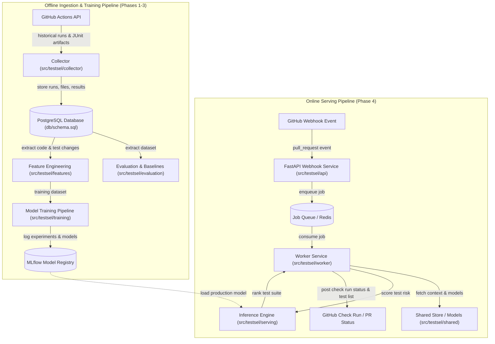

# testsel: Predictive Test Selection for CI

Testsel is an intelligent continuous integration system and GitHub App that accelerates developer velocity by predicting test failure risk on incoming pull requests. By mining historical CI execution data, commit diffs, and test report artifacts, Testsel trains machine learning ranking models that select and prioritize high-risk tests—providing rapid feedback to developers while conserving cloud CI compute.

## Project Status

- **Current Status**: **Phase 0 (Monorepo & Base Setup) Complete**
- **Next Milestone**: **Phase 1 (Data Collection Pipeline & Historical Ingestion)**

| Phase | Milestone | Owner | Status |
|---|---|---|---|
| Phase 0 | Monorepo Base, Tooling, CI, & Architecture | Both | Complete |
| Phase 1 | GitHub Collector, JUnit Parser, Postgres Ingestion | Person A | In Progress |
| Phase 2 | Time-Split Dataset Creation & Benchmark Baselines | Person A | Planned |
| Phase 3 | Feature Engineering & LightGBM Ranking Models | Person A | Planned |
| Phase 4 | Model Serving, Worker Queue, & FastAPI GitHub App | Person B | Planned |
| Phase 5 | React Web Dashboard & Metrics Visualization | Person B | Planned |
| Phase 6 | Pilot Deployment & Shadow Mode Evaluation | Both | Planned |
| Phase 7 | Production Deployment & Adaptive Retraining | Both | Planned |

---

## How It Works

Testsel operates across two synchronized lifecycles: an **offline ML training loop** that extracts failure patterns from past PRs, and an **online inference service** that receives GitHub pull request webhooks and emits prioritized check runs.



---

## Repository Layout

```
testsel/
├── .github/
│   ├── workflows/ci.yml       # GitHub Actions CI workflow (lint + test)
│   ├── ISSUE_TEMPLATE/        # Task and bug issue templates
│   ├── CODEOWNERS             # Component ownership boundaries (@person-a, @person-b)
│   └── PULL_REQUEST_TEMPLATE.md
├── configs/
│   └── repos.yaml             # Target repositories and artifact patterns for collection
├── data/                      # Local cached responses and downloaded artifacts (gitignored)
├── db/
│   ├── schema.sql             # PostgreSQL schema definition (runs, files, tests, results)
│   └── migrations/            # Future database schema migrations
├── docs/
│   ├── adr/                   # Architecture Decision Records (e.g. 0001-stack-choices.md)
│   ├── architecture.md        # Detailed architecture and sequence flows
│   └── dataset-notes.md       # Target repository notes and data quality logs
├── infra/
│   ├── docker/
│   │   └── collector.Dockerfile # Standalone container definition for collector service
│   ├── k8s/                   # Kubernetes deployment manifests (future phase)
│   └── monitoring/            # Prometheus / Grafana monitoring configs (future phase)
├── notebooks/                 # Exploratory data analysis and feature research
├── scripts/                   # Utility maintenance and data processing scripts
├── src/testsel/
│   ├── __init__.py            # Root package docstring and exports
│   ├── cli.py                 # Command line interface (init-db, collect, collect-all)
│   ├── api/                   # FastAPI webhook receiver and GitHub App endpoints (Phase 4)
│   ├── collector/             # GitHub API client, JUnit parser, and ingestion loop (Phase 1)
│   ├── evaluation/            # Time-split evaluation, metrics, and baseline heuristics (Phase 2)
│   ├── features/              # Code change and test history feature engineering (Phase 3)
│   ├── serving/               # Model inference engine and test ranking logic (Phase 4)
│   ├── shared/                # Shared DB store, models, configuration, and interfaces
│   ├── training/              # LightGBM training pipelines and tuning (Phase 3)
│   └── worker/                # Asynchronous queue worker processes (Phase 4)
├── tests/
│   ├── unit/                  # Unit tests (test_collector, test_github_client, test_junit)
│   ├── integration/           # Integration tests against live PostgreSQL or APIs
│   └── fixtures/              # Sample XML reports and test payloads
├── web/                       # React frontend dashboard (Phase 5)
├── .editorconfig              # Editor indentation and line ending rules
├── .env.example               # Template environment configuration (fake placeholders)
├── .gitignore                 # Ignored files (secrets, virtualenv, caches, data)
├── .pre-commit-config.yaml    # Git pre-commit hooks (ruff, whitespace, yaml check)
├── AGENTS.md                  # Context and conventions for AI coding tools
├── CONTRIBUTING.md            # Git branching, commit messages, and PR rules
├── docker-compose.yml         # Local PostgreSQL and collector container orchestration
├── Makefile                   # Standard developer command automation
└── pyproject.toml             # Python packaging, dependency, and tool specifications
```

---

## Prerequisites

- **Python**: `>= 3.12` (check with `python --version` or `py -3.12 --version`)
- **Docker & Docker Compose**: Docker Engine v24+ / Docker Compose v2+
- **Git**: Git 2.30+
- **make** (optional on Windows, native on macOS/Linux)

---

## Quickstart

### On Windows (Git Bash)

1. **Clone the repository and enter directory**:
   ```bash
   cd testsel
   ```

2. **Create and activate Python 3.12 virtual environment**:
   ```bash
   py -3.12 -m venv .venv
   source .venv/Scripts/activate
   ```

3. **Install dependencies in editable mode**:
   ```bash
   make install
   # or without make: pip install -e ".[dev]"
   ```

4. **Install Git pre-commit hooks**:
   ```bash
   pre-commit install
   ```

5. **Configure environment variables**:
   ```bash
   cp .env.example .env
   # Edit .env and supply your GitHub Personal Access Token(s)
   ```

6. **Start local PostgreSQL**:
   ```bash
   make up
   # or without make: docker compose up -d postgres
   ```

7. **Run test suite**:
   ```bash
   make test
   # or without make: pytest -q
   ```

---

### On macOS / Linux

1. **Clone the repository and enter directory**:
   ```bash
   cd testsel
   ```

2. **Create and activate Python 3.12 virtual environment**:
   ```bash
   python3.12 -m venv .venv
   source .venv/bin/activate
   ```

3. **Install dependencies in editable mode**:
   ```bash
   make install
   ```

4. **Install Git pre-commit hooks**:
   ```bash
   pre-commit install
   ```

5. **Configure environment variables**:
   ```bash
   cp .env.example .env
   # Edit .env and supply your GitHub Personal Access Token(s)
   ```

6. **Start local PostgreSQL**:
   ```bash
   make up
   ```

7. **Run test suite**:
   ```bash
   make test
   ```

---

## Make Commands

| Command | Underlying Action | Purpose |
|---|---|---|
| `make help` | `@echo ...` | Display table of available make targets |
| `make install` | `pip install -e ".[dev]"` | Install package and dev tools in active venv |
| `make up` | `docker compose up -d postgres` | Start PostgreSQL container with auto-applied schema |
| `make down` | `docker compose down` | Stop running Docker Compose services |
| `make psql` | `docker compose exec postgres psql -U testsel -d testsel` | Open PostgreSQL interactive shell inside container |
| `make test` | `pytest -q` | Run complete unit and regression test suite |
| `make lint` | `ruff check . && ruff format --check .` | Validate code style and formatting |
| `make fmt` | `ruff check --fix . && ruff format .` | Auto-format code and apply safe autofixes |
| `make collect`| `testsel collect-all --config configs/repos.yaml` | Execute historical collection across configured repos |

*Note: If `make` is not installed on Windows, execute the command listed under the "Underlying Action" column directly in Git Bash.*

---

## Team Workflow

### Ownership Matrix

| Subsystem / Directory | Primary Owner | Description |
|---|---|---|
| `src/testsel/collector/` | Person A | GitHub API pagination, ETag caching, JUnit parsing, run ingestion |
| `src/testsel/evaluation/`| Person A | Time-split dataset generation, baseline benchmarks (Random, FileMatch), Recall@K |
| `src/testsel/features/`  | Person A | Commit diff analysis, file-test co-occurrence, author and test history features |
| `src/testsel/training/`  | Person A | Model training pipeline, LightGBM rankers, hyperparameter optimization |
| `src/testsel/serving/`   | Person B | Real-time test risk inference engine, ranking decision thresholding |
| `src/testsel/api/`       | Person B | FastAPI webhook endpoint receiver and GitHub App authentication |
| `src/testsel/worker/`    | Person B | Asynchronous job consumer queue processing background inference |
| `web/`                   | Person B | React developer dashboard, ROI metrics, test execution insights |
| `infra/`                 | Person B | Dockerfiles, Compose specs, deployment manifests, telemetry |
| `src/testsel/shared/`    | Both | Domain models (`TestResult`, `RunRecord`), store protocol, app configuration |
| `db/`                    | Both | PostgreSQL schema definitions and versioned migrations |
| `.github/`               | Both (Person B reviews) | CI/CD actions, pull request templates, and automation |

### Git Rules & PR Standards

- **Branch Naming**: Use prefixes: `feat/<feature-name>`, `fix/<bug-fix>`, `docs/<topic>`, `chore/<task>`.
- **Commit Messages**: Follow Conventional Commits format (e.g., `feat(collector): add multi-token retry backoff`).
- **PR Size**: Restrict PRs to `< 400 lines` of diff to facilitate rigorous code review.
- **Review Requirements**: PRs touching a module must be reviewed and approved by the other team member.
- **Merge Strategy**: Always **Squash and Merge** to preserve a clean, linear git history.

---

## Roadmap

| Phase | Duration | Scope & Key Deliverables |
|---|---|---|
| **Phase 0** | Week 1 | Base monorepo setup, tooling (ruff, pytest, pre-commit), Docker Compose, CI workflows. |
| **Phase 1** | Months 1–2 | Historical CI run collector, rate-limited GitHub client, safe JUnit XML parsing, PostgreSQL storage. |
| **Phase 2** | Month 3 | Time-ordered data extraction, baseline heuristics (Test-All, Random, FileMatch, FailHistory), Recall@K evaluation. |
| **Phase 3** | Months 4–5 | Feature extraction pipeline (code churn, test age, flakiness), LightGBM ranking model training, MLflow tracking. |
| **Phase 4** | Months 6–7 | FastAPI webhook receiver, async queue worker, model serving inference engine, GitHub Check Run status posting. |
| **Phase 5** | Month 8 | React frontend dashboard (`web/`), historical savings visualization, audit logging, model health monitoring. |
| **Phase 6** | Month 9 | Shadow mode pilot on real repositories, prediction latency benchmarking, false-negative analysis. |
| **Phase 7** | Ongoing | Live test selection enforcement, automated scheduled model retraining, DVC feature store scaling. |

---

## Troubleshooting

### Port 5432 is Already in Use
If an existing PostgreSQL instance is running locally on port `5432`, `docker compose up` will fail with an address binding error:
- **Windows**: Check running services via PowerShell:
  ```powershell
  Get-Service -Name *postgres*
  Stop-Service -Name postgresql*
  ```
- **macOS / Linux**:
  ```bash
  sudo lsof -i :5432
  sudo systemctl stop postgresql
  ```
- Alternatively, modify the host port mapping in `docker-compose.yml` to `"5433:5432"` and update `DATABASE_URL` in `.env`.

### Docker Daemon Permissions
If `docker compose up` reports permission denied on Linux or macOS:
- Ensure your user is part of the `docker` group:
  ```bash
  sudo usermod -aG docker $USER
  ```
- Restart your shell session or run `newgrp docker`.

### Windows Git Bash Line Endings & Symlinks
- If pre-commit or Git flags file modification due to line endings (`CRLF` vs `LF`), run:
  ```bash
  git config --global core.autocrlf false
  ```
- Repository `.editorconfig` enforces `LF` across all text files.

### WSL2 / Docker Desktop Integration
- Ensure Docker Desktop has WSL2 backend enabled under **Settings > General > Use the WSL 2 based engine**.
- Ensure your distro is checked under **Settings > Resources > WSL Integration**.

---

## License

This project is licensed under the terms of the MIT License (see `LICENSE` file for details).
