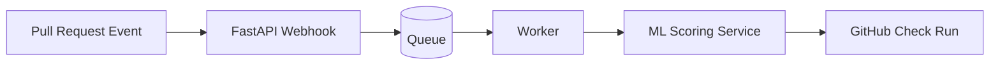

# testsel

> A GitHub App that analyzes code diffs in pull requests and ranks test suites by predicted failure risk using custom-trained ML models—cutting CI wait times while catching regressions early.

**Status**: Phase 0 complete, Phase 1 (data collection) in progress. See [docs/PROGRESS.md](docs/PROGRESS.md).

## The Problem
Modern CI test suites often take 20 to 60+ minutes to complete, forcing developers to context-switch while waiting for pull request feedback. In large test suites, the vast majority of tests pass unconditionally, while the few tests that fail are run late in the run or buried in deep matrices. Running all tests indiscriminately wastes significant compute budgets and slows team release velocity. `testsel` solves this by predicting high-risk tests from code changes and prioritizing them so regressions surface in minutes.

## How It Works
When a pull request is opened or updated, `testsel` extracts file diff signals, queries historical test failure frequencies, scores candidate test cases using a LightGBM model, and publishes prioritized test execution orders to GitHub Actions via Check Runs. See [docs/architecture.md](docs/architecture.md) for full architecture details.

## Planned Results
*Target evaluation metrics to be filled after Phase 3 model training:*

| Metric | Target | Baseline (Run All) |
| :--- | :--- | :--- |
| Failure Recall @ Top 20% | TBD (Phase 3) | 20% |
| CI Time Saved | TBD (Phase 3) | 0% |
| End-to-End Ranking Latency | < 5s | N/A |

## Tech Stack
- **Backend & ML**: Python 3.12, FastAPI, LightGBM, MLflow
- **Storage & Ingestion**: PostgreSQL 16, GitHub REST API
- **Tooling & Infra**: Docker Compose, Ruff, Pytest, pre-commit, GitHub Actions

## Getting Started
To set up your local environment, launch services, and run tests, see **[docs/development.md](docs/development.md)**.
For branching models and PR submission standards, see **[CONTRIBUTING.md](CONTRIBUTING.md)**.
To track milestones and active work items, check **[docs/PROGRESS.md](docs/PROGRESS.md)**.

## License
This project is licensed under the MIT License.
