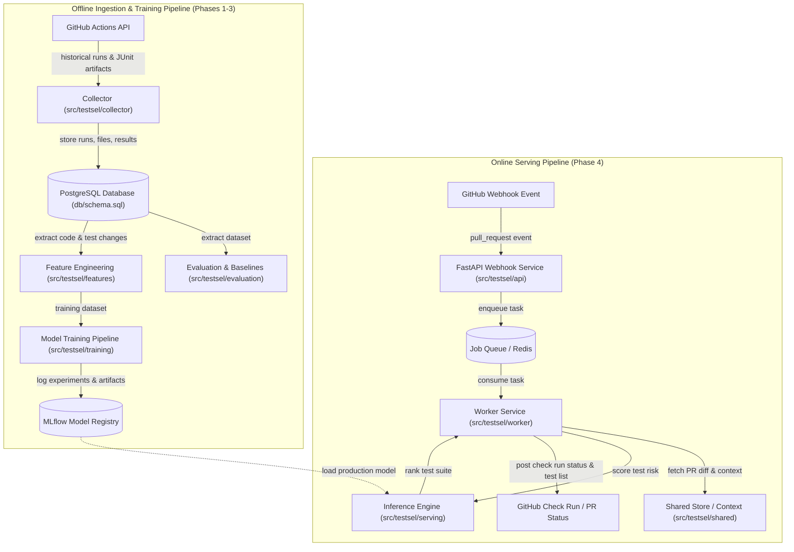

# Testsel Architecture

## Overview
Testsel is a predictive test selection system consisting of two main operational loops:
1. **Online Serving Pipeline**: Ingests GitHub webhook events when pull requests update, enqueues ranking requests, runs inference to score test failure probability, and reports test selection decisions back to GitHub Check Runs.
2. **Offline Ingestion & Training Pipeline**: Continuously collects workflow runs, changed files, and JUnit XML test artifacts, builds time-split tabular datasets, trains ML ranking models, and registers model candidates for serving.

## System Flow Diagram

## Module Boundaries
- `src/testsel/collector/`: GitHub client, rate-limiting token pool, safe JUnit XML / zip extraction, and ingestion loop.
- `src/testsel/shared/`: Database connection management, domain models (`TestResult`, `ChangedFile`, `RunRecord`), and shared configuration.
- `src/testsel/features/`: Extraction of code metrics, commit features, and historical test failure rates.
- `src/testsel/evaluation/`: Time-split data splits, test selection baseline heuristics (e.g. Test-All, Random, File-match, Historical-fail), and ranking evaluation metrics (Recall@K, Saved CI time).
- `src/testsel/training/`: Offline training scripts, LightGBM rankers, and hyperparameter tuning.
- `src/testsel/serving/`: Model loading, inference ranking, and test filtering rules.
- `src/testsel/api/`: FastAPI webhook receivers and GitHub App verification.
- `src/testsel/worker/`: Async task queue workers executing scoring jobs.
- `web/`: React single-page application dashboard for audit metrics and savings visualization.
